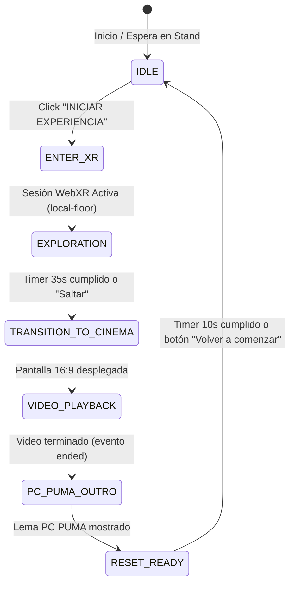

# Arquitectura de Software: UNAM Immersive Experience – PC PUMA
## Motor de Ejecución: VXR Core (Three.js + WebXR)

---

## 1. Visión General del Sistema

**UNAM Immersive Experience** es una aplicación WebXR diseñada para stands de difusión tecnológica y eventos académicos de la UNAM y el programa **PC PUMA**. La aplicación permite que un asistente se coloque un visor **Meta Quest 3S / Meta Quest 3** y sea transportado a una reconstrucción tridimensional estilizada de **Ciudad Universitaria (Las Islas)**, experimente una sesión guiada con giro de cabeza 360°, observe una transición cinematográfica y visualice un video institucional 16:9 en una pantalla virtual de alta fidelidad, culminando con el cierre oficial de PC PUMA y un reinicio automático para el próximo visitante.

El motor central es **VXR Core**, un framework modular basado en Three.js y los estándares abiertos de WebXR, optimizado específicamente para el navegador Meta Quest Browser.

```
┌────────────────────────────────────────────────────────────────────────┐
│                   UNAM IMMERSIVE EXPERIENCE (APP)                      │
├────────────────────────────────────────────────────────────────────────┤
│                       ExperienceManager                                │
│       (Máquina de Estados Finita: IDLE ➔ ENTER_XR ➔ EXPLORATION        │
│          ➔ TRANSITION ➔ VIDEO_PLAYBACK ➔ OUTRO ➔ RESET_READY)          │
├───────────────────┬───────────────────┬────────────────────────────────┤
│    UNAMScene      │    VideoScreen    │         Stand Operator         │
│  - Architecture   │  - 16:9 Curved    │           Console              │
│  - Environment    │  - PBR Frame      │  - SyncChannel (Broadcast)     │
│  - Vegetation     │  - VideoTexture   │  - Remote Trigger & Telemetry  │
│  - Lighting       │  - Audio Unmute   │  - Live State Monitor          │
├───────────────────┴───────────────────┴────────────────────────────────┤
│                              VXR CORE                                  │
│  - XRApp          - XRScene           - XRRenderer    - XRSession      │
│  - XRAssetManager - WebXRRuntime      - questDetection- XRInput        │
├────────────────────────────────────────────────────────────────────────┤
│                        THREE.JS ENGINE (WebGL2)                        │
└────────────────────────────────────────────────────────────────────────┘
```

---

## 2. Máquina de Estados de la Experiencia

El flujo del visitante está gestionado por `ExperienceManager` como una máquina de estados determinista:



### Detalle de cada Estado:
1. **`IDLE`**: La experiencia muestra la pantalla de bienvenida institucional en modo reposo. Espera a que el visitante o el operador dé clic en **INICIAR EXPERIENCIA**.
2. **`ENTER_XR`**: Se solicita al navegador la sesión `immersive-vr` con el espacio de referencia `local-floor`. Se calibra la posición del usuario en el origen de Las Islas ($Y=1.6\text{ m}$) y se reanuda el `AudioContext`.
3. **`EXPLORATION`**: El visitante contempla el campus universitario (Biblioteca Central con los murales de Juan O'Gorman, Torre de Rectoría con el mural de David Alfaro Siqueiros, andadores de tezontle, rocas del pedregal y jacarandas). La rotación natural de la cabeza permite una visión 360° fluida sin necesidad de controles manuales. Un HUD discreto indica el tiempo restante (35 segundos por defecto).
4. **`TRANSITION_TO_CINEMA`**: La luz solar diurna se atenúa suavemente a modo cine (`setCinemaMode(true)`), se reproduce un acorde armónico ceremonial con `XRAudio` y una pantalla virtual 16:9 animada emerge frente al espectador.
5. **`VIDEO_PLAYBACK`**: El archivo de video local (`video-institucional.mp4`) se reproduce sobre la malla 3D mediante `THREE.VideoTexture` con audio sincronizado. Al detectar el evento `ended` de HTML5, el estado avanza automáticamente.
6. **`PC_PUMA_OUTRO`**: La pantalla de video se oculta y emerge el panel tridimensional con el lema institucional: *"PC PUMA: Tecnología para transformar el aprendizaje"*.
7. **`RESET_READY`**: Se muestra el mensaje de agradecimiento y el botón 3D interactivo **VOLVER A COMENZAR**. Tras 10 segundos de inactividad o un toque con el gatillo del mando Quest, se ejecuta `resetExperience()`, liberando recursos de memoria y dejando la aplicación lista para el siguiente participante sin recargar la página.

---

## 3. Optimizaciones para Meta Quest 3S y Meta Quest 3

Para garantizar una tasa de cuadros estable de 72 a 90 FPS en el visor portátil sin calentamiento:
- **`pixelRatioCap: 1.25`**: Evita que el compositor WebXR renderice a densidades excesivas que saturen la GPU del Snapdragon XR2.
- **Luz Direccional Única**: Una sola fuente de luz con sombras activas (`PCFSoftShadowMap` de $1024 \times 1024$ píxeles), con sesgo calibrado (`bias: -0.0003`, `normalBias: 0.02`).
- **Instancing y Compartición de Geometrías**: La vegetación (jacarandas, fresnos y rocas volcánicas) reutiliza mallas y materiales base en memoria.
- **Liberación de Memoria (Zero Leaks)**: Al reiniciar, se detiene el elemento `<video>`, se remueve su atributo `src`, se llama a `video.load()` y se liberan las texturas de la GPU.

---

## 4. Comunicación con el Panel de Operador

La experiencia y la consola de operador se comunican mediante **`SyncChannel`**, una implementación desacoplada basada en `BroadcastChannel`:
- El operador puede estar en una laptop o tableta junto al visor y monitorear la tasa de cuadros por segundo, el estado actual de la experiencia y el avance del video.
- Permite forzar el inicio, saltar directamente al video, saltar al cierre o reiniciar el sistema de manera remota.
